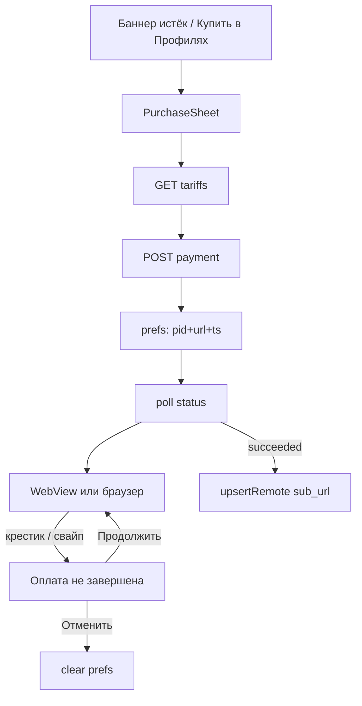

# In-app payment (`feature/in-app-payment`)

Оплата и продление подписки из приложения без обязательного ухода в Telegram-бота.

**Целевые платформы:** Android и Windows.  
**Не в scope:** iOS (сборка/поддержка оплаты под iOS не делается).

## Новые возможности (сводка)

| Фича | Поведение |
|------|-----------|
| **Покупка в приложении** | Тарифы с API → платёж → страница оплаты → опрос статуса → импорт `sub_url` в профили |
| **Баннер истечения** | Осталось ≤ 3 дней → Telegram-бот; уже истекла → лист оплаты |
| **Купить из Профилей** | Кнопка «Купить подписку» у гостя и у залогиненного → тот же лист |
| **Android WebView** | Оплата внутри приложения; СБП / банк — схемы `sbolpay:` / `intent:` уходят в систему |
| **Windows** | Страница оплаты в системном браузере + опрос статуса в листе |
| **Незавершённая оплата** | `pending_payment` = `{pid, url, ts}`; после выхода из WebView — «Продолжить» / «Отменить» / «Проверить снова» |
| **Чип в Профилях** | «Есть незавершённая оплата» → открывает лист с recovery |
| **Опрос до WebView** | Статус крутится, пока пользователь в банке (СБП), не ждёт закрытия экрана оплаты |
| **Гостевая покупка** | Без Telegram-логина; при успехе импорт профиля + опционально `claim_url` |

Открыть лист из кода: `showPurchaseSheet(context)`.



## Зачем

Раньше баннер истечения всегда открывал `@AxiOm_buy_bot`. Покупка шла вне приложения, а ссылка на подписку возвращалась вручную.

Теперь при **уже истёкшей** подписке приложение само:

1. запрашивает каталог тарифов с бэкенда;
2. создаёт платёж;
3. открывает страницу оплаты;
4. опрашивает статус;
5. импортирует `sub_url` в профили (и обновляет аккаунт, если пользователь залогинен).

Тарифы **не зашиты** в клиент: цены и состав меняются на сервере, а выпущенная сборка обновляется не у всех сразу.

## Поведение баннера истечения

| Состояние | Тап по баннеру |
|-----------|----------------|
| Подписка ещё активна, осталось ≤ 3 дней (3 / 2 / 1 / «последний день») | Telegram-бот `https://t.me/AxiOm_buy_bot` |
| Подписка уже истекла | Лист покупки → страница оплаты |

Баннер можно скрыть крестиком до перезапуска приложения (не персистится).

## Платформы: как открывается оплата

| Платформа | Страница оплаты |
|-----------|-----------------|
| **Android** | Встроенный WebView (`PaymentWebViewPage`) |
| **Windows** | Системный браузер (`url_launcher`) |
| iOS / прочее | Не целевые; WebView для оплаты не используется |

На Android закрытие WebView завязано на редирект return URL с маркером `paid=1`. Опрос `/api/app/payment/status` стартует **до** открытия страницы оплаты (раз в 3 с, потолок 15 мин): пока пользователь в приложении банка по СБП, статус уже подтягивается; если WebView закрыли руками после оплаты — тоже.

Маркер ищется как **query-параметр** (`paid=1`), а не подстрокой всего URL: подстрока могла бы встретиться на промежуточной странице платёжки и закрыть оплату на полпути. Реальный return URL берётся из `PAYMENT_RETURN_URL` на бэкенде (`https://design.arcohouse.space/?paid=1`).

На Windows колбэка из браузера нет — подтверждение только через опрос статуса. В листе показывается подсказка вернуться в приложение после оплаты.

### СБП и приложения банков

Платёжка уводит на **не-http(s)** схемы (`sbolpay:`, `bank100000000111:`, `intent:`) — WebView такую ссылку отрисовать не может и показывает страницу ошибки, на чём оплата и заканчивается. Поэтому `onNavigationRequest` отдаёт всё, кроме `http`/`https`, системе (`launchUrl(..., externalApplication)`) и отменяет навигацию внутри WebView.

`canLaunchUrl` перед этим **намеренно не вызывается**: на Android 11+ он отвечает `false` для схемы, не перечисленной в `<queries>` манифеста, а перечислить все банковские приложения невозможно. Вместо проверки — `try/catch` вокруг запуска.

### Незавершённая оплата (выход из WebView / свайп листа)

Перед открытием страницы оплаты в `SharedPreferences` пишется ключ `pending_payment`:

```json
{"pid": "...", "url": "https://...", "ts": 1710000000}
```

`url` нужен, чтобы после закрытия WebView крестиком можно было **открыть ту же страницу оплаты снова** — одного `pid` для этого мало.

При открытии листа (`showPurchaseSheet`) сохранённый платёж подхватывается: опрос статуса продолжается, сверху показывается блок **«Оплата не завершена»** с действиями:

| Кнопка | Действие |
|--------|----------|
| **Продолжить оплату** | снова WebView / браузер по сохранённому `url` + опрос |
| **Проверить снова** | после таймаута 15 мин — перезапуск опроса без нового заказа |
| **Отменить ожидание** | стоп таймера, очистка prefs, тарифы снова доступны |

Запись удаляется при `succeeded`, `canceled`, `not_found`, по кнопке «Отменить ожидание» и по возрасту старше **24 часов**. Таймаут опроса (15 мин) **не** чистит prefs — можно проверить статус или открыть оплату снова.

Хелпер: `showPurchaseSheet(context)` в `purchase_sheet.dart`. Баннер истечения и вкладка Профили открывают один и тот же лист.

### Вкладка Профили (секция аккаунта)

В [`account_section.dart`](../lib/features/account/widget/account_section.dart):

- кнопка **«Купить подписку»** (гость и залогиненный) → `showPurchaseSheet`;
- если есть живой pending — чип **«Есть незавершённая оплата»** и подпись кнопки меняется на **«Продолжить оплату»**.

Полноценный редизайн ЛК (история платежей и т.д.) — отдельно; здесь только вход в покупку и recovery.

## API (бэкенд уже развёрнут)

База: `Constants.accountApiBaseUrl` → `https://axiom.arcohouse.space`

| Метод | Эндпоинт | Назначение |
|-------|----------|------------|
| `GET` | `/api/app/tariffs` | Каталог тарифов |
| `POST` | `/api/app/payment` | Создать платёж (`tariff_idx`, опционально `method`, `promo`) |
| `GET` | `/api/app/payment/status?pid=…` | Статус: `pending` \| `succeeded` \| `canceled` \| `not_found` |

Авторизация опциональна:

- с `Authorization: Bearer <session>` покупка привязывается к Telegram-аккаунту;
- без токена в ответе успеха может прийти `claim_url` для привязки позже.

Ошибки показываются человеческим текстом, а не `DioException`: 429 → «Сервер занят, попробуйте через минуту», поле `error` из тела ответа — как есть, отсутствие ответа → «Нет связи с сервером».

Ответ создания платежа:

- обычный путь: `{ payment_id, payment_url }`;
- 100% скидка: `{ status: "succeeded", sub_url }` — платить не нужно.

Успешный статус / бесплатная выдача:

- `sub_url` — ссылка подписки (импортируется в профили);
- опционально `claim_url` — кнопка «Привязать» в UI.

Клиент: `lib/features/account/data/account_api.dart`  
(`getTariffs`, `createPayment`, `getPaymentStatus`).

## Файлы в ветке

| Файл | Роль |
|------|------|
| `lib/features/account/widget/home_expiry_banner.dart` | Баннер: бот vs лист оплаты |
| `lib/features/account/widget/purchase_sheet.dart` | Лист тарифов, оплата, опрос, recovery, `showPurchaseSheet` |
| `lib/features/account/widget/payment_webview_page.dart` | WebView оплаты (Android) |
| `lib/features/account/widget/account_section.dart` | ЛК в Профилях: купить / pending |
| `lib/features/account/data/account_api.dart` | HTTP к тарифам/платежам |
| `pubspec.yaml` | `webview_flutter` (нужен для Android) |

## Гостевая покупка vs аккаунт

- **Залогинен:** после успеха вызывается `accountNotifier.refresh()` → автоимпорт активных подписок + явный `upsertRemote(sub_url)`.
- **Гость:** `sub_url` всё равно импортируется в профили; если импорт не удался — текст просит скопировать ссылку вручную; при наличии `claim_url` показывается «Привязать».

## Проверка перед мержем / релизом

1. `flutter pub get`
2. `dart analyze` по затронутым файлам account/widget + account_api
3. Сборка **Android** release APK и сценарии:
   - баннер «осталось N дней» → бот;
   - баннер «истекла» → тарифы → оплата в WebView → успех → профиль появился;
   - гость без Telegram-логина;
   - залогиненный аккаунт;
   - **закрыть WebView крестиком** → «Продолжить оплату» / «Отменить ожидание»;
   - **смахнуть лист** после создания платежа → Профили → чип незавершённой оплаты → recovery;
   - **СБП / оплата через приложение банка**: WebView отдаёт ссылку системе, банк открывается, после возврата опрос подтверждает оплату.
4. Сборка **Windows** и сценарий: истекла → тарифы → браузер → после оплаты статус в листе → профиль.
5. Бамп версии в `pubspec.yaml` / appcast при выкладке (ветка пока на базе 4.3.2).

## Лимиты на сервере

`/api/app/payment/status` ограничен 60 запросами в минуту, ключ — **`pid`** (`app_api.py`, `handle_app_payment_status`; выкачено на RU 02.09.2026).

Раньше ключом был `Authorization` или IP клиента, и это ломалось именно у гостей: приложение ходит к API через собственный туннель, поэтому сервер видит IP выходного узла, общий для всех за ним. Опрос даёт 20 запросов в минуту на человека — трое одновременно платящих гостей за одним узлом выбирали лимит, и остальные получали `429` вместо подтверждения оплаты. Платёж принадлежит одному покупателю, так что ключ по `pid` и честнее, и не задевает соседей; своих 60 в минуту одному опросу хватает втрое.

Проверено на боевом: 60 запросов с одним `pid` проходят, 61-й отдаёт `429`, запрос с другим `pid` в этот же момент — обычный ответ.

Остальные лимиты не менялись: `/api/app/payment` — 10/мин по `Authorization` или IP (создание платежа к `pid` не привязать), `/api/app/tariffs` — 60/мин по IP.

## Известные ограничения

- Старый `pending_payment` без поля `url` (сборки до этого фикса) всё ещё resume’ит опрос, но кнопка «Продолжить оплату» скрыта — только «Проверить снова» / «Отменить ожидание» или новый заказ после отмены.

## Вне scope

- iOS: не поддерживаем, WebView оплаты под iOS не целевой путь.
- Промокод в UI (поле `promo` в API есть, экрана ввода нет).
- Выбор метода оплаты в UI (`method` опционален на сервере).
